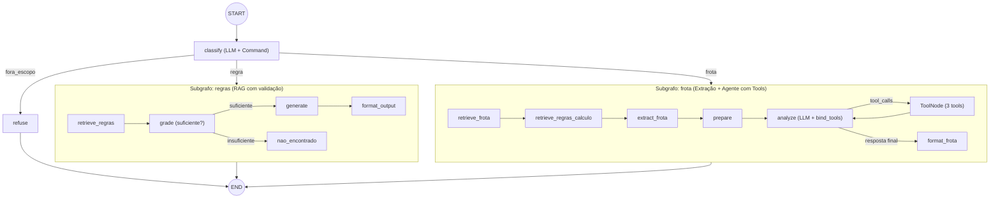

# Semana 3 — Exercício 2: Agente Multi-Fluxo de Operações Portuárias (LangGraph + Langfuse)

Resolução do **Exercício 2 da Semana 3**, evoluindo o pipeline RAG para uma arquitetura **multi-fluxo com subgrafos em LangGraph**, roteamento via `Command`, validação de contexto (*Corrective RAG*), extração estruturada e agente ReAct com ferramentas determinísticas (**Azure OpenAI** + **Langfuse**).

---

## Arquitetura e Fluxos



### Fluxos disponíveis
1. **Classificação (`classify`)**: usa saída estruturada (`TypedDict` + `Literal`) e `Command(update=..., goto=...)` para classificar a pergunta em `regra`, `frota` ou `fora_escopo` e rotear diretamente.
2. **Subgrafo `regras` (RAG validado)**:
   - `retrieve_regras`: busca `k=3` trechos em `data/manual_operacoes.txt`.
   - `grade`: valida se o contexto contém resposta explícita (`suficiente: bool`).
   - Se suficiente → `generate` → `format_output` (com citação de fontes deduplicadas).
   - Se insuficiente → `nao_encontrado` (`"Não encontrado no manual de operações."`).
3. **Subgrafo `frota` (Extração + Agente ReAct com Tools)**:
   - `retrieve_frota` (`k=10` em `relatorio_frota.txt`) + `retrieve_regras_calculo` (`k=4` em `manual_operacoes.txt`).
   - `extract_frota`: converte os textos em dados estruturados (Pydantic) ordenados por navio + limite de velocidade em tempestade na rota direta.
   - `prepare` → loop `analyze ⇄ tools`: executa cálculos determinísticos via `ToolNode` (`reserva_ok`, `velocidade_efetiva`, `calcular_eta_horas`).
   - `format_frota`: monta a resposta final com todas as fontes acumuladas.
4. **Fora de escopo (`refuse`)**: recusa diretamente sem custo adicional de retrieval ou geração.

---

## Estrutura do Projeto

```text
semana3-exercicio2/
├── data/
│   ├── manual_operacoes.txt        # Manual de Operações do Porto Alfa
│   ├── relatorio_frota.txt         # Situação atual dos 4 navios da frota
│   └── avaliacao.json              # Dataset de perguntas para avaliação automatizada
├── scripts/
│   └── avaliar.py                  # Script de avaliação sobre data/avaliacao.json
├── src/
│   ├── app/
│   │   └── main.py                 # CLI interativa principal
│   ├── graph/
│   │   ├── builder.py              # Grafo pai + subgrafos build_regras_graph / build_frota_graph
│   │   ├── state.py                # State (TypedDict) com reducers add_messages e operator.add
│   │   ├── routing.py              # Função condicional route_after_grade
│   │   ├── tools.py                # Tools: reserva_ok, velocidade_efetiva, calcular_eta_horas
│   │   ├── prompts/                # Templates de prompt (classify, grade, rag, extract, analyze)
│   │   └── nodes/
│   │       ├── classify.py         # Classificação e roteamento via Command
│   │       ├── refuse.py           # Recusa de perguntas fora de escopo
│   │       ├── regras/             # Nós do subgrafo de regras (RAG)
│   │       └── frota/              # Nós do subgrafo de frota (Agente + Tools)
│   └── infra/
│       ├── llm_adapter.py          # Fábricas get_llm() e get_embeddings() (Azure OpenAI)
│       ├── vector_store.py         # Chunking por ## + InMemoryVectorStore com @lru_cache
│       └── langfuse_client.py      # CallbackHandler opcional e flush() do Langfuse
├── .env.example                    # Modelo de variáveis de ambiente
├── requirements.txt
└── README.md
```

---

## Configuração do Ambiente

### 1. Criar e ativar o ambiente virtual

```powershell
python -m venv .venv
.\.venv\Scripts\Activate.ps1
pip install -r requirements.txt
```

### 2. Configurar variáveis de ambiente

Copie `.env.example` para `.env` na raiz do projeto e preencha suas credenciais:

```powershell
Copy-Item .env.example .env
```

---

## Como Executar

### CLI interativa

```powershell
.\.venv\Scripts\python.exe -m src.app.main
```

Digite sua pergunta no terminal (ou `sair`, `exit`, `quit` para encerrar).

### Script de avaliação

```powershell
.\.venv\Scripts\python.exe -m scripts.avaliar
```
